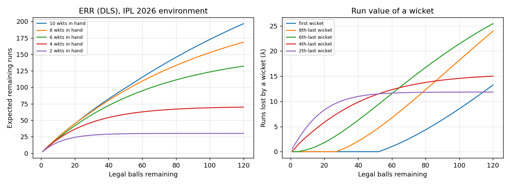

# T5 — Scoring environment & expected-remaining-runs model

Generated by `src/models_par.py`. Training rows = legal balls of complete, non-reduced first innings (n = 96,768 balls, 812 innings).

## Scoring environment (env_par: shrunk tier × season mean first-innings total)

| tier | year | env_par | n_innings |
|---|---|---|---|
| T1_IPL | 2022 | 172.9 | 74 |
| T1_IPL | 2023 | 183.4 | 71 |
| T1_IPL | 2024 | 189.6 | 70 |
| T1_IPL | 2025 | 191.5 | 69 |
| T1_IPL | 2026 | 194.6 | 71 |
| T2_T20I_TOP | 2022 | 172.9 | 71 |
| T2_T20I_TOP | 2023 | 178.3 | 46 |
| T2_T20I_TOP | 2024 | 179.6 | 59 |
| T2_T20I_TOP | 2025 | 171.6 | 74 |
| T2_T20I_TOP | 2026 | 183.9 | 49 |
| T3_T20I_OTHER | 2022 | 163.9 | 27 |
| T3_T20I_OTHER | 2023 | 153.6 | 11 |
| T3_T20I_OTHER | 2024 | 156.5 | 40 |
| T3_T20I_OTHER | 2025 | 161.8 | 37 |
| T3_T20I_OTHER | 2026 | 165.1 | 13 |
| T4_A_TEAM | 2024 | 157.0 | 15 |
| T4_A_TEAM | 2025 | 154.5 | 15 |

## Leave-one-season-out validation (MAE of remaining runs)

| held_out_year | DLS | GLM | HGB | naive_cell_mean |
|---|---|---|---|---|
| 2022 | 15.53 | 15.55 | 15.59 | 15.88 |
| 2023 | 16.45 | 16.53 | 16.63 | 16.83 |
| 2024 | 16.87 | 16.95 | 16.91 | 17.87 |
| 2025 | 16.56 | 16.60 | 16.64 | 17.49 |
| 2026 | 18.00 | 18.07 | 18.11 | 18.77 |

| model | MAE_weighted | mean_bias |
|---|---|---|
| DLS | 16.629 | 0.104 |
| GLM | 16.687 | 0.051 |
| HGB | 16.717 | 0.262 |
| naive_cell_mean | 17.339 | 0.167 |

## Candidate validity gate (fitted on all training rows)

A candidate must be non-decreasing in balls remaining and in wickets in hand on the full 120 × 10 state grid (tolerance 0.5 run) and never give a negative wicket value. Among passing candidates the lowest LOSO MAE wins; within 1% the simpler model is preferred (DLS < GLM < HGB).

| model | balls_dir_violations | wkts_dir_violations | cells | min_wicket_value | LOSO_MAE | passes |
|---|---|---|---|---|---|---|
| DLS | 0 | 0 | 1200 | 0.00 | 16.63 | True |
| GLM | 79 | 58 | 1200 | -5269.94 | 16.69 | False |
| HGB | 0 | 0 | 1200 | 0.00 | 16.72 | True |

**Selected model: DLS**.

Monotonicity on a 120 × 10 grid (IPL 2026 env, tolerance 0.5 run): {'balls_dir_violations': 0, 'wkts_dir_violations': 0, 'cells': 1200}

## Expected remaining runs, IPL 2026 environment (env_par = 194.6)

| index | 10 wkts | 7 wkts | 5 wkts | 3 wkts | 1 wkts |
|---|---|---|---|---|---|
| 120 balls left | 196.6 | 144.5 | 106.7 | 55.0 | 18.2 |
| 90 balls left | 159.5 | 128.2 | 98.6 | 53.9 | 18.2 |
| 60 balls left | 115.3 | 102.7 | 83.2 | 50.4 | 18.1 |
| 30 balls left | 64.3 | 62.7 | 54.4 | 38.7 | 17.3 |
| 12 balls left | 28.5 | 28.5 | 25.9 | 21.1 | 12.7 |
| 6 balls left | 14.9 | 14.9 | 13.8 | 11.8 | 8.2 |

## Run value of losing a wicket (λ), IPL 2026 environment

Column = wickets in hand *before* the wicket falls.

| index | 10 wkts | 7 wkts | 5 wkts | 3 wkts | 1 wkts |
|---|---|---|---|---|---|
| 120 balls left | 13.2 | 12.4 | 36.8 | 24.9 | 18.2 |
| 90 balls left | 6.3 | 10.5 | 30.5 | 23.9 | 18.2 |
| 60 balls left | 1.0 | 7.9 | 20.5 | 20.6 | 18.1 |
| 30 balls left | 0.0 | 4.5 | 7.6 | 11.4 | 17.3 |
| 12 balls left | 0.0 | 1.9 | 1.1 | 2.5 | 12.7 |
| 6 balls left | 0.0 | 1.0 | 0.0 | 0.3 | 8.2 |

