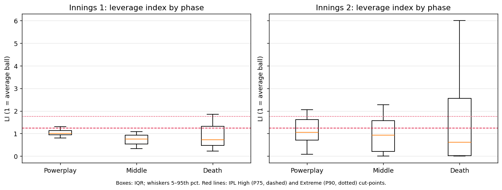

# T7 — Pressure labelling & construct validation

Generated by `src/pressure.py`. Reference set = legal balls of decided matches with a WP estimate (n = 188,218). LI = expected |ΔWP| of the next ball ÷ its mean.

## Tier cut-points (LI quantiles within IPL / non-IPL)

| is_ipl | P50 | P75 | P90 | li_cap |
|---|---|---|---|---|
| False | 0.917 | 1.225 | 1.762 | 4.787 |
| True | 0.904 | 1.234 | 1.757 | 4.787 |

## 1. Outcome relevance

- High + Extreme balls are **25.0%** of balls but carry **49.8%** of all realised win-probability movement (|WPA|).
- Extreme alone: 10.0% of balls, 27.9% of |WPA|.

## 2. Separation: league outcomes by pressure tier (95% match-cluster bootstrap CI)

Batting outcomes on legal balls; runs = runs off the bat.

### Innings 1 — raw rates

| pressure_tier | balls | runs_per_ball | dot_pct | boundary_pct | dismissal_pct |
|---|---|---|---|---|---|
| Low | 51467 | 1.45 [1.43, 1.48] | 32.78 [32.08, 33.47] | 18.38 [17.83, 18.92] | 5.90 [5.72, 6.09] |
| Moderate | 36625 | 1.33 [1.31, 1.34] | 41.21 [40.53, 41.77] | 18.69 [18.26, 19.15] | 4.63 [4.39, 4.83] |
| High | 8225 | 1.45 [1.40, 1.50] | 38.74 [37.41, 39.96] | 20.35 [19.37, 21.45] | 6.76 [6.27, 7.30] |
| Extreme | 2135 | 1.60 [1.51, 1.68] | 30.59 [28.35, 32.98] | 20.84 [19.18, 22.80] | 7.68 [6.56, 8.88] |

### Innings 2 — raw rates

| pressure_tier | balls | runs_per_ball | dot_pct | boundary_pct | dismissal_pct |
|---|---|---|---|---|---|
| Low | 42641 | 1.38 [1.35, 1.40] | 38.35 [37.63, 39.11] | 18.64 [18.10, 19.16] | 5.83 [5.59, 6.08] |
| Moderate | 10427 | 1.42 [1.38, 1.45] | 38.58 [37.62, 39.64] | 20.37 [19.57, 21.22] | 5.20 [4.78, 5.69] |
| High | 20010 | 1.37 [1.34, 1.40] | 36.18 [35.33, 36.92] | 17.94 [17.32, 18.59] | 5.05 [4.75, 5.38] |
| Extreme | 16688 | 1.38 [1.35, 1.42] | 37.81 [36.74, 38.91] | 18.51 [17.84, 19.20] | 6.57 [6.13, 7.00] |

### Context-adjusted (actual − expected for the same innings × phase × wickets-in-hand; positive = above normal)

Units: runs per ball; percentage points for dot / boundary / dismissal.

#### Innings 1

| pressure_tier | balls | runs_per_ball | dot_pct | boundary_pct | dismissal_pct |
|---|---|---|---|---|---|
| Low | 51467 | 0.03 [0.01, 0.05] | -0.27 [-0.78, 0.22] | 0.64 [0.19, 1.09] | 0.12 [-0.04, 0.31] |
| Moderate | 36625 | -0.03 [-0.05, -0.01] | 0.20 [-0.43, 0.71] | -0.70 [-1.10, -0.26] | -0.16 [-0.40, 0.04] |
| High | 8225 | -0.03 [-0.08, 0.01] | 0.98 [-0.20, 2.11] | -0.65 [-1.64, 0.33] | 0.20 [-0.31, 0.70] |
| Extreme | 2135 | -0.04 [-0.12, 0.05] | -0.61 [-2.69, 1.66] | -0.88 [-2.51, 1.01] | -0.89 [-2.02, 0.32] |

#### Innings 2

| pressure_tier | balls | runs_per_ball | dot_pct | boundary_pct | dismissal_pct |
|---|---|---|---|---|---|
| Low | 42641 | 0.01 [-0.02, 0.03] | 0.46 [-0.13, 1.05] | 0.38 [-0.15, 0.84] | -0.14 [-0.36, 0.09] |
| Moderate | 10427 | 0.03 [-0.00, 0.06] | -1.02 [-1.96, -0.04] | 0.62 [-0.14, 1.39] | 0.03 [-0.36, 0.52] |
| High | 20010 | -0.01 [-0.04, 0.02] | -0.69 [-1.43, 0.03] | -0.55 [-1.14, 0.03] | -0.02 [-0.31, 0.28] |
| Extreme | 16688 | -0.03 [-0.06, 0.00] | 0.30 [-0.63, 1.24] | -0.71 [-1.31, -0.07] | 0.35 [-0.08, 0.75] |

## 3. Where pressure occurs (% of balls in each tier by innings × phase)

| innings | phase | Low | Moderate | High | Extreme |
|---|---|---|---|---|---|
| 1 | DEATH | 63.5 | 9.2 | 18.3 | 9.0 |
| 1 | MID | 72.0 | 27.0 | 1.0 | 0.0 |
| 1 | PP | 14.1 | 74.5 | 11.4 | 0.0 |
| 2 | DEATH | 55.7 | 4.7 | 6.8 | 32.9 |
| 2 | MID | 49.6 | 9.6 | 27.3 | 13.5 |
| 2 | PP | 39.8 | 18.5 | 24.0 | 17.7 |

- Death-over balls classified **Low** leverage: 60.2%; middle-over balls classified High/Extreme: 20.5%.

## 4. Convergence with the rule-based Pressure Index (model B)

| innings | n | spearman_LI_PI | pressure_share | kappa_same_share |
|---|---|---|---|---|
| 1 | 98452 | -0.019 | 0.105 | 0.029 |
| 2 | 89766 | 0.653 | 0.409 | 0.417 |

Interpretation threshold set in planning/03 §4: Spearman < 0.4 ⇒ explain disagreement.

## 5. Situation flags S1–S6 (descriptive)

| index | balls | share_high_extreme_% | mean_LI |
|---|---|---|---|
| S1_tight_chase_death | 3135.00 | 100.00 | 4.75 |
| S2_after_collapse | 38887.00 | 25.45 | 1.01 |
| S3_steep_chase | 17157.00 | 57.57 | 1.36 |
| S4_defending_close | 7148.00 | 100.00 | 3.69 |
| S5_first_inns_death_below_par | 10687.00 | 47.17 | 1.11 |
| S6_knockout | 6553.00 | 26.25 | 1.00 |

## 6. Face validity (random samples, seed fixed)

### 10 Extreme-leverage balls

| match_id | innings | overid | score_before | wkts_before | runs_needed_before | balls_rem_before | wp_state | li | pressure_tier |
|---|---|---|---|---|---|---|---|---|---|
| 46753 | 2 | 18 | 125 | 6 | 27.00 | 18 | 0.65 | 5.82 | Extreme |
| 40746 | 2 | 18 | 172 | 6 | 35.00 | 16 | 0.30 | 5.62 | Extreme |
| 45498 | 2 | 4 | 24 | 1 | 137.00 | 102 | 0.52 | 2.08 | Extreme |
| 19692 | 1 | 19 | 131 | 6 |  | 7 | 0.40 | 1.96 | Extreme |
| 40732 | 2 | 5 | 41 | 1 | 158.00 | 93 | 0.48 | 1.81 | Extreme |
| 16654 | 2 | 2 | 3 | 1 | 145.00 | 114 | 0.65 | 1.90 | Extreme |
| 40709 | 2 | 19 | 178 | 4 | 26.00 | 9 | 0.28 | 5.38 | Extreme |
| 45504 | 2 | 13 | 76 | 3 | 71.00 | 46 | 0.54 | 2.08 | Extreme |
| 17737 | 2 | 6 | 35 | 1 | 133.00 | 88 | 0.56 | 1.83 | Extreme |
| 50377 | 2 | 3 | 17 | 2 | 152.00 | 107 | 0.54 | 2.23 | Extreme |

### 10 Low-leverage death-over balls

| match_id | innings | overid | score_before | wkts_before | runs_needed_before | balls_rem_before | wp_state | li | pressure_tier |
|---|---|---|---|---|---|---|---|---|---|
| 13612 | 2 | 18 | 104 | 7 | 39.00 | 12 | 0.02 | 0.45 | Low |
| 50188 | 1 | 19 | 173 | 6 |  | 8 | 0.61 | 0.70 | Low |
| 45491 | 1 | 16 | 116 | 6 |  | 26 | 0.21 | 0.89 | Low |
| 40741 | 1 | 18 | 176 | 5 |  | 17 | 0.65 | 0.45 | Low |
| 42784 | 1 | 17 | 164 | 3 |  | 19 | 0.77 | 0.80 | Low |
| 30070 | 2 | 18 | 138 | 9 | 44.00 | 13 | 0.00 | 0.01 | Low |
| 20220 | 1 | 18 | 169 | 6 |  | 15 | 0.62 | 0.39 | Low |
| 29815 | 1 | 20 | 209 | 6 |  | 2 | 0.73 | 0.79 | Low |
| 41511 | 1 | 18 | 122 | 7 |  | 14 | 0.19 | 0.66 | Low |
| 40715 | 1 | 18 | 190 | 6 |  | 15 | 0.67 | 0.74 | Low |

