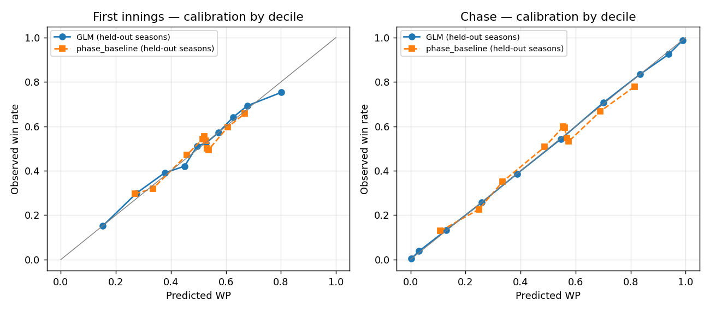

# T6 — Win-probability models

Generated by `src/models_wp.py`. Target = batting side wins (ties / no-results excluded). Training rows = legal balls with `wp_usable` (reliable targets, decided matches).

## Chase (innings 2)

Training rows: 89,766 legal balls from 829 matches.

### Leave-one-season-out (log-loss, lower is better)

| held_out_year | GLM | HGB | phase_baseline |
|---|---|---|---|
| 2022 | 0.3589 | 0.3612 | 0.6005 |
| 2023 | 0.4801 | 0.4694 | 0.6104 |
| 2024 | 0.4099 | 0.4123 | 0.5957 |
| 2025 | 0.3560 | 0.3662 | 0.6130 |
| 2026 | 0.3422 | 0.3679 | 0.5898 |

### Pooled LOSO metrics

| model | log_loss | brier | auc | calib_slope | calib_intercept |
|---|---|---|---|---|---|
| GLM | 0.3867 | 0.1251 | 0.9075 | 1.0354 | 0.0125 |
| HGB | 0.3925 | 0.1274 | 0.9050 | 1.0050 | 0.0120 |
| phase_baseline | 0.6022 | 0.2090 | 0.7162 | 0.9971 | -0.0044 |

### Monotonicity gate (IPL 2026 environment; tolerance 0.01 WP)

| model | x_dir_violations | balls_dir_violations | wkts_dir_violations | grid_points | LOSO_log_loss | passes |
|---|---|---|---|---|---|---|
| GLM | 0 | 0 | 0 | 100800 | 0.3867 | True |
| HGB | 0 | 0 | 0 | 100800 | 0.3925 | True |

**Selected: GLM**

## First innings

Training rows: 98,452 legal balls from 834 matches.

### Leave-one-season-out (log-loss, lower is better)

| held_out_year | GLM | HGB | phase_baseline |
|---|---|---|---|
| 2022 | 0.6137 | 0.6140 | 0.6650 |
| 2023 | 0.6463 | 0.6551 | 0.6624 |
| 2024 | 0.6306 | 0.6389 | 0.6786 |
| 2025 | 0.6048 | 0.6123 | 0.6563 |
| 2026 | 0.6628 | 0.6416 | 0.6680 |

### Pooled LOSO metrics

| model | log_loss | brier | auc | calib_slope | calib_intercept |
|---|---|---|---|---|---|
| GLM | 0.6289 | 0.2193 | 0.7069 | 1.0089 | 0.0094 |
| HGB | 0.6305 | 0.2199 | 0.7013 | 0.8908 | -0.0676 |
| phase_baseline | 0.6661 | 0.2369 | 0.6193 | 0.9968 | -0.0014 |

### Monotonicity gate (IPL 2026 environment; tolerance 0.01 WP)

| model | x_dir_violations | balls_dir_violations | wkts_dir_violations | grid_points | LOSO_log_loss | passes |
|---|---|---|---|---|---|---|
| GLM | 0 | 0 | 0 | 61200 | 0.6289 | True |
| HGB | 0 | 0 | 0 | 61200 | 0.6305 | True |

**Selected: GLM**

## Coherence checks

- Innings-break continuity: |WP(last ball of inn 1, first-innings model) − WP(first ball of chase, chase model)|: median 0.032, 90th pct 0.078 (n = 840).
- Deliveries with a WP estimate: 99.8% of innings-1/2 deliveries (missing = unreliable chase targets).

### Worked example — match 20248 (IPL 2023, chase lost by 1 run): last 8 deliveries

| striker_name | runs_needed_before | balls_rem_before | total_runs | wp_before | wp_after |
|---|---|---|---|---|---|
| Vaibhav Arora | 21.000 | 6 | 1 | 0.078 | 0.062 |
| Rinku Singh | 20.000 | 5 | 1 | 0.062 | 0.076 |
| Rinku Singh | 19.000 | 5 | 0 | 0.076 | 0.048 |
| Rinku Singh | 19.000 | 4 | 0 | 0.048 | 0.010 |
| Rinku Singh | 19.000 | 3 | 1 | 0.010 | 0.035 |
| Rinku Singh | 18.000 | 3 | 6 | 0.035 | 0.079 |
| Rinku Singh | 12.000 | 2 | 4 | 0.079 | 0.010 |
| Rinku Singh | 8.000 | 1 | 6 | 0.010 | 0.000 |

